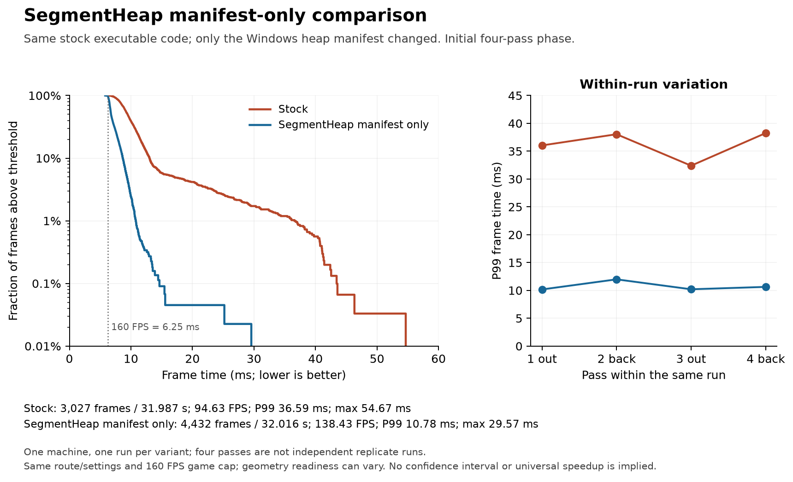
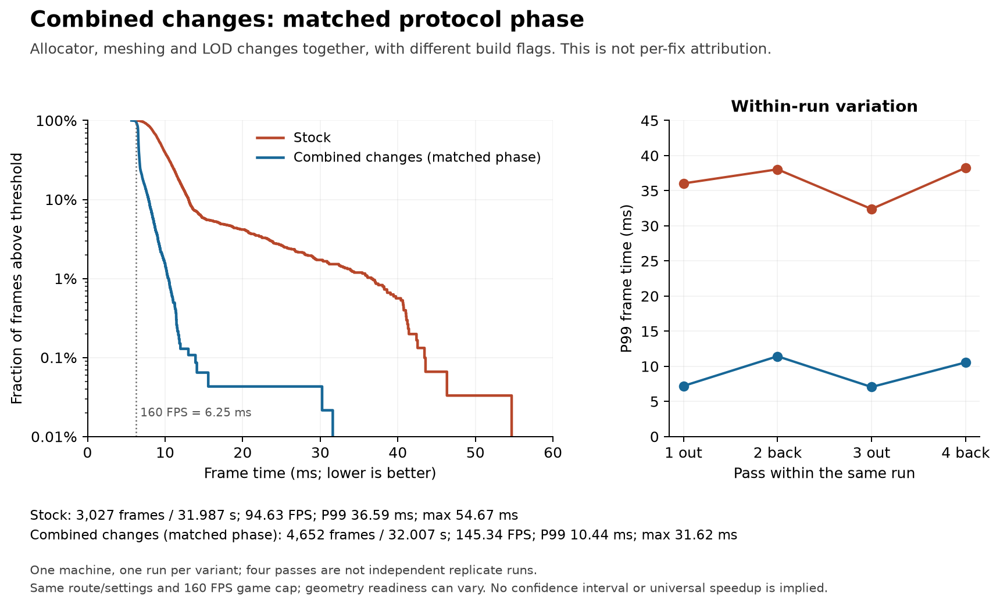
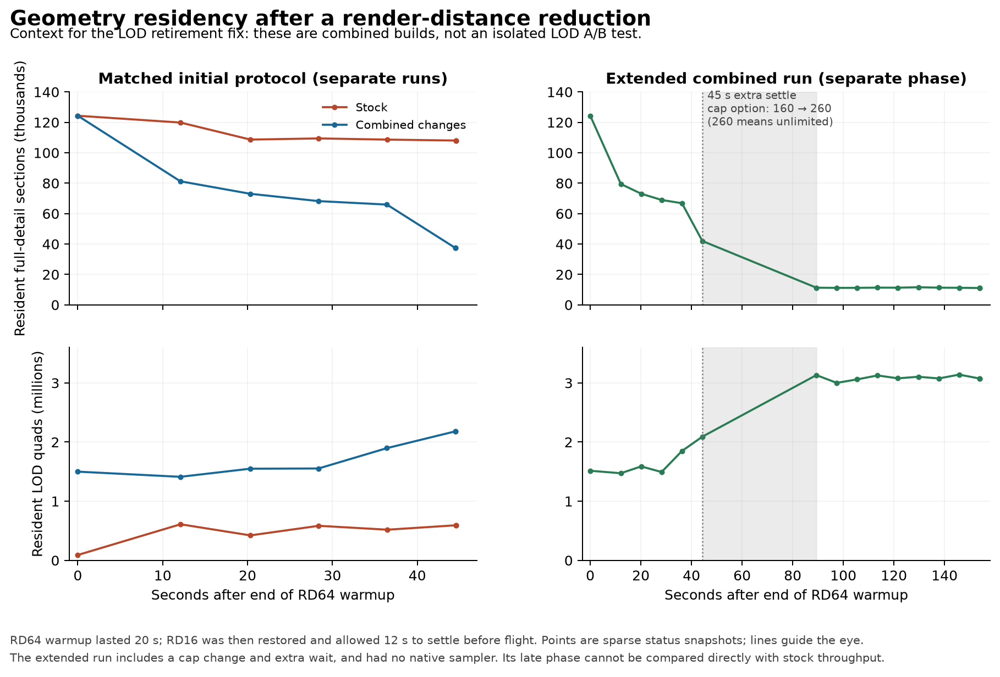
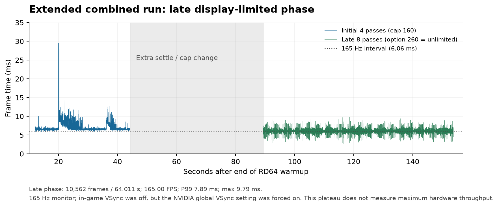

# Local performance evidence

These measurements document one troubleshooting session on one Windows machine. They support a manifest-only SegmentHeap experiment and provide context for a **combined** allocator/meshing/LOD build. They do not establish a performance benefit for an isolated LOD, mesh-scratch, or mimalloc patch.

The recorded executable/source baseline was `baa379d71777f06a95b4e7650b2209a3d4209033`. The independent PR branches were subsequently adapted to `bd665f28a`; **those updated branches were not runtime-benchmarked here**. Correctness tests on the PR branches are separate from these measurements.

## Recorded results

All aggregate statistics below are recalculated from the concatenated frame-time arrays in [data.json.gz](data.json.gz), rather than averages of per-pass percentiles. FPS is `N * 1000 / sum(frame_ms)`; percentiles use nearest rank `ceil(p * N) - 1` in the sorted samples. The elapsed duration is the sum of captured frame durations, excluding control-command overhead between passes. [summary.json](summary.json) contains the small aggregate/protocol summary and SHA-256 hashes of the chart source dataset and plotting script.

| Run / phase | Flights | Frames | Captured seconds | Average FPS | P99 (ms) | Maximum (ms) | Frames >25 ms |
|---|---:|---:|---:|---:|---:|---:|---:|
| Stock, initial | 4 | 3,027 | 31.986562232 | 94.633489 | 36.594200 | 54.674000 | 79 |
| SegmentHeap manifest only, initial | 4 | 4,432 | 32.015550098 | 138.432730 | 10.783200 | 29.572500 | 2 |
| Combined changes, matched initial | 4 | 4,652 | 32.006756500 | 145.344312 | 10.441900 | 31.615398 | 2 |
| Separate extended combined run, initial | 4 | 4,644 | 32.009894663 | 145.080140 | 10.777000 | 29.552401 | 2 |
| Separate extended combined run, late | 8 | 10,562 | 64.011356010 | 165.001972 | 7.889800 | 9.785999 | 0 |

There was one startup/warmup cycle for each variant. The four route passes within a run are correlated samples, not four independent benchmark replications. No confidence interval or cross-machine claim is implied.

### SegmentHeap experiment



The manifest-only binary preserves the stock executable's non-resource sections byte for byte, and preserves its original resources. The new Windows application manifest selects SegmentHeap. This is the narrowest available comparison: no Rust source or machine-code change was made between these two executables. Run order was not randomized or repeated, and geometry readiness still varied, so the observed size of the difference should not be treated as a universal allocator speedup. SVG: [segmentheap-frame-times.svg](segmentheap-frame-times.svg).

### Combined experiment



The combined build includes the allocator changes, mesh scratch reuse, worker scratch retention limits, LOD retirement detail requests, and mesh queue/in-flight scheduling changes. It also uses a different build profile. Its better frame-time distribution cannot be assigned to any one of those changes. SVG: [combined-frame-times.svg](combined-frame-times.svg).

### Residency context



At the final initial-phase snapshots, stock had 108,036 resident full-detail sections at 44.5619693 seconds after warmup, while the combined run had 37,410 at 44.5060007 seconds. In the separate extended combined run, the final snapshot had 11,078 full-detail sections and 3,074,708 LOD quads at 153.8755078 seconds. The stock trace ends at its last observation; it is not extrapolated into the extended phase.

The combined build began the RD16 period with substantially more LOD geometry already ready than stock. Equal wall-time warmups therefore did **not** establish equal rendering work or equal initial LOD state. Sparse snapshots and lines joining them do not establish when individual replacements occurred. This chart is consistent with the intended retirement behavior, but an isolated LOD-only experiment is still needed for attribution. SVG: [lod-residency.svg](lod-residency.svg).

The stock initial-phase final arena allocation was 6,811,447,296 bytes. The combined initial-phase final allocation was 6,979,215,360 bytes despite fewer resident sections; reserved arena capacity can lag retirement. The separate extended combined final allocation was 1,610,588,160 bytes. Comparing that later value to stock describes different settling durations, not an immediate matched-phase memory reduction.

### Late phase and the 165 FPS ceiling



After the first four flights in the extended run, `maxFps` changed from 160 to 260 (260 means unlimited in this game), followed by an extra 45-second stationary settle and eight more flights. The native sampler was absent from the entire extended run. The late 165 FPS plateau matches the 165 Hz monitor; a read-only driver inspection found NVIDIA global VSync forced on even though in-game VSync was off. This phase measures a display-limited result under different conditions, not maximum hardware throughput or a direct stock-versus-fixed comparison. SVG: [sustained-frame-times.svg](sustained-frame-times.svg).

## Protocol and provenance

Hardware: Intel Core i9-13900K, NVIDIA GeForce RTX 3090, Windows 11, 2560 × 1440 visible Vulkan window. Each variant used a fresh copy of the same saved world and settings, automatic workers (31 worker threads observed), simulation distance 9, LOD distance 64/full, unlimited chunk updates, and in-game VSync off. No compilation ran during these runtime comparisons.

Each run started with the same camera position/orientation, a five-second initial settle, RD64 for 20 seconds, a return to RD16, and a 12-second settle. Four 256-block flights then alternated out/back, taking eight seconds each (32 blocks/s), with the in-game FPS cap at 160. Debug and frame-time overlays were visible. Exact world contents and camera coordinates are private and are not included in this package.

The initial stock, SegmentHeap-only, and combined runs had a 20 Hz native main-thread sampler during their early flights for 15 seconds. Each context capture briefly suspended the thread, resuming it before stack walking; a separate validation probe measured mean/max suspension of approximately 0.133/0.365 ms. Sampling can perturb timings. The extended run used no sampler.

Binary SHA-256 values:

| Variant | SHA-256 |
|---|---|
| Stock official executable | `9e6915e254fc3347190fcc4cd29bfcb97f54cb7bd730e7e41563f0ed29b63436` |
| Stock plus SegmentHeap manifest | `7845b3646e635f2d9a88f16ac1360d01149de3ea9f846995bdd1936a42e3055e` |
| Combined build | `151524b630d42a0947871c7c6583c6a294b1efed788675d7e631760b9c311639` |

The combined executable was built with Rust 1.99.1, a `fast` profile inheriting release with `opt-level=3`, LTO disabled, 16 codegen units, incremental compilation enabled, and line-table debug information; default audio/controller features plus Windows mimalloc. The versions were `mimalloc 0.1.52` / `libmimalloc-sys 0.1.49`. SegmentHeap was added after linking. The official executable's exact build flags were not recorded, so the combined comparison is not build-profile controlled.

The separate [heap-probe.json](heap-probe.json) strips absolute timestamps from a validated native sampling observation. During one outbound flight, 112 of 242 samples at 20 Hz showed main-thread process-heap lock waits (46.2809917355% sampled wall-time occupancy). A caller observed in 65 samples was validated at the PE import/instruction level as `GetProcessHeap` followed by `HeapReAlloc`. Verified native function address ranges are retained. This is not an exact percentage of frame cost; periodic sampling can alias periodic work. A matching PDB for stock was unavailable, so no exact Rust source function is identified. Nearest-export labels with large offsets were not used as function identities.

## Regenerate or collect new data

Python 3.10+ and matplotlib are needed to redraw the figures. Download [data.json.gz](data.json.gz) and [prepare_evidence.py](prepare_evidence.py) into one directory. The sanitized dataset is sufficient; the game, private world, logs, and raw control snapshots are not required:

```console
python -m pip install matplotlib
python prepare_evidence.py --data data.json.gz
```

The script writes four PNG and four SVG figures beside itself, plus a deterministic `data.json.gz` archive (`mtime=0`, no source filename) and `summary.json`. It accepts uncompressed `.json` as well. A local uncompressed copy is retained for inspection; the public download uses gzip. To repeat the whitelist extraction from the original locally retained raw files, use `python prepare_evidence.py --input-dir PATH_TO_PRIVATE_RAW_FILES`; the expected filenames are `fix-bench-stock.json`, `fix-bench-segment.json`, `fix-bench-final.json`, and `fix-bench-sustained.json`. It copies only numeric timing arrays and explicit residency fields, relative game uptime, and generic protocol/provenance; it excludes raw player state, world names, coordinates, paths, process IDs, absolute timestamps, account data, and telemetry.

[run_benchmark.py](run_benchmark.py) is a portable collection script for a reviewer's own binaries, resource directory, world copy and settings. `python run_benchmark.py --help` lists the required local inputs. Run one fresh process per variant, with a separate `--output` file and private `--scratch-parent`; the script never connects to an existing game. It copies the world to an isolated home, changes the benchmark settings there, runs the protocol and quits only its own process. Console logs and world contents stay in the private scratch directory; only the whitelist metrics go to `--output`. The collection script was syntax/help checked here, not runtime-executed. It does not include the native sampler and cannot recreate the private world from this package. Record driver VSync and graphics settings separately when collecting new runs.

For an isolated LOD follow-up, compare the same current-main executable with and without only the retirement patch, with identical compiler flags, allocator, driver settings and sampler state. Use multiple fresh cycles in randomized order. Poll residency, request masks and retiring-column counts at a fixed cadence after the RD64→RD16 reduction; keep the camera stationary until the diagnostic window ends, then run the same flight route. Check that full-detail retention decreases only after the requested replacement summary/detail becomes ready, and verify the absence of holes/cutout regressions. Report that new result separately from the combined curves above.
